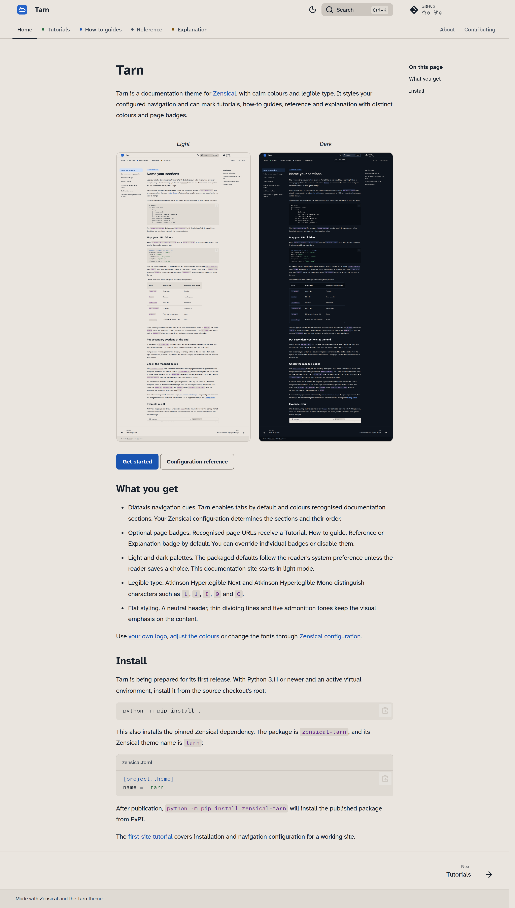
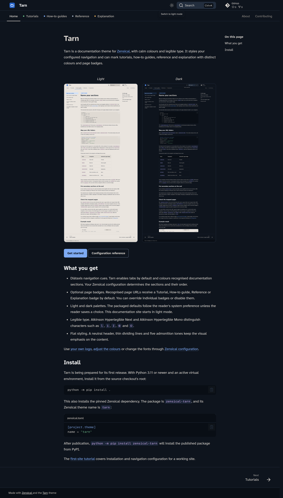
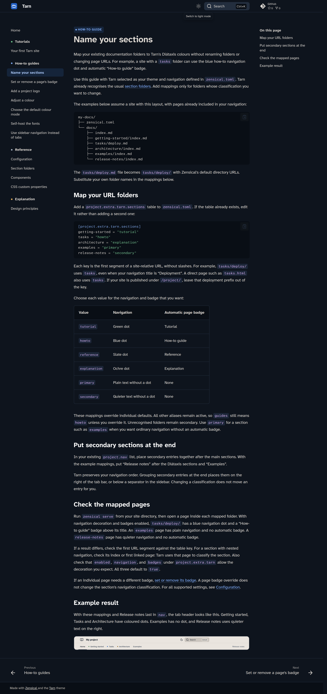
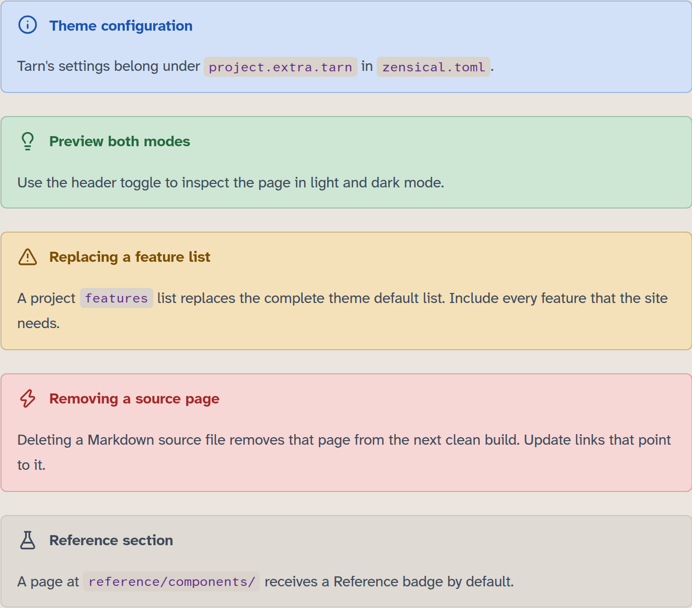
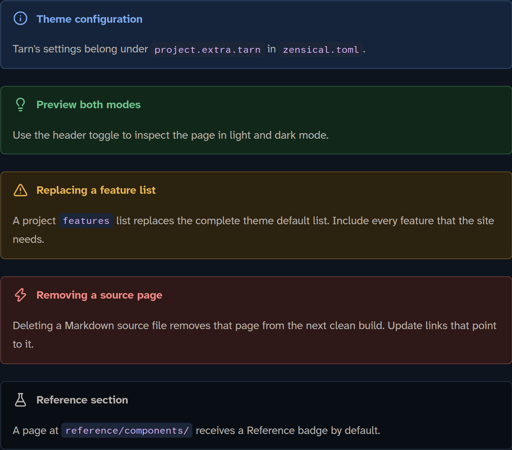
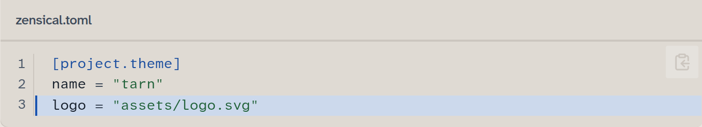
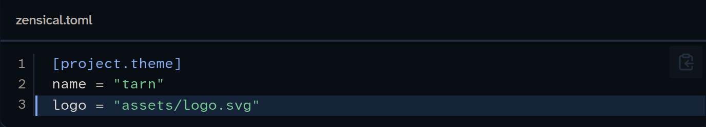

<p align="center"></p>

<h1 align="center">Tarn</h1>

<p align="center">A quiet, Diátaxis-aware documentation theme for <a href="https://zensical.org">Zensical</a>.</p>


Tarn combines calm colours, legible type and Diátaxis navigation in a restrained layout for documentation.

- **Diátaxis navigation cues.** Recognised sections get coloured dots on navigation tabs or sidebar headings. Recognised page URLs receive a Tutorial, How-to guide, Reference or Explanation badge by default. You can override individual badges or disable badges and navigation decoration separately. Unrecognised sections use quieter, secondary styling by default.
- **Light and dark** palettes follow the reader's system preference by default, unless the reader saves a choice. Projects can choose their starting mode.
- **Legible type**: Atkinson Hyperlegible Next and Mono.
- **Flat and focused**: a neutral header, thin dividing lines, five admonition tones for Zensical's twelve types, and inline code that stands out from prose and links.
- **Tabs or sidebar**: works with `navigation.tabs` (default) or `navigation.sections`.
- **Contrast checked**: the default text/background token pairs pass the generator’s 4.5:1 checks in both themes.

## Install

Tarn is being prepared for its first release. It requires Python 3.11 or newer
and pins Zensical to version 0.0.73. See the
[configuration reference](docs/reference/configuration.md) for dependency details.

With an active virtual environment, install from the source checkout's root:

```bash
python -m pip install .
```

This also installs Zensical. After publication,
`python -m pip install zensical-tarn` will install the published package from PyPI.
Select the theme in your project's configuration:

```toml
# zensical.toml
[project.theme]
name = "tarn"
```

Zensical can also read `mkdocs.yml` with the equivalent theme selection.
MkDocs itself has not been verified:

```yaml
theme:
  name: tarn
```

Tarn styles the navigation you configure in Zensical and preserves its order.
Folders such as `tutorials/`, `how-to/`, `reference/` and `explanation/` have
built-in classifications. The homepage defaults to primary styling. Unknown
URL sections default to secondary styling. Use `project.extra.tarn.sections`
to map existing folders or mark a section as primary. The
[first-site tutorial](docs/tutorials/first-site.md) covers a working site, and
[Name your sections](docs/how-to/name-sections.md) explains custom mappings.

You can [add your own logo](docs/how-to/add-project-logo.md),
[adjust colours](docs/how-to/adjust-colours.md) and change the fonts through
[Zensical configuration](docs/reference/configuration.md#fonts-and-css).

## Screenshots

| Light | Dark |
| --- | --- |
|  |  |
|  |  |
|  |  |
|  |  |

More in [`screenshots/`](screenshots/).

## Documentation

The theme's own documentation, built with Tarn: <https://axelvoitier.github.io/zensical-tarn/>

## Licence

Copyright Axel Voitier. Original Tarn material is licensed under [Apache 2.0](LICENSE).
Includes modified Zensical templates under MIT; see [NOTICE](NOTICE) and the
[upstream licence](LICENSES/zensical-ui.MIT.txt). The combined package metadata
records `Apache-2.0 AND MIT`. Fonts are fetched from Google Fonts, with
[self-hosting instructions](docs/how-to/self-host-fonts.md).
