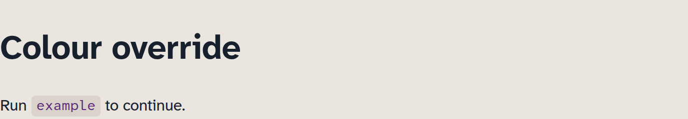

# Adjust a colour

To change a colour on your site, override its CSS custom property in your own
stylesheet. A custom property is a named value such as `--tarn-inline-ink`.

As an example here, we will change the text colour of inline code in light mode in an existing Tarn site.

## Add the colour override

Create `docs/stylesheets/extra.css`, or add this rule to that file if it exists:

```css title="docs/stylesheets/extra.css"
[data-md-color-scheme="default"] {
  --tarn-inline-ink: #5b2a7a;
}
```

The `default` selector applies the override only in light mode. For a separate
dark-mode colour, add another rule with `data-md-color-scheme="slate"` and a
colour suited to its background.

## Load the stylesheet

Add the stylesheet path to `extra_css` in your existing `[project]` table:

```toml title="zensical.toml"
[project]
extra_css = ["stylesheets/extra.css"]
```

If you already have `extra_css`, append `"stylesheets/extra.css"` to that list.
Keep its existing entries, and add your override last. Do not create a second
`[project]` table.

## Preview the change

Add an inline code example to a Markdown page:

```markdown
Run `example` to continue.
```

Run `zensical serve` and open that page in light mode. The word `example` uses
`#5b2a7a` on the existing inline-code background. Switch to dark mode to confirm
that it still uses Tarn's dark-mode colour.

Inline code outside links uses your colour in light mode. Code blocks retain
their existing colours.

## Check the contrast

Use [WebAIM's Contrast Checker](https://webaim.org/resources/contrastchecker/?fcolor=5B2A7A&bcolor=D9D3CC)
to compare the text colour with its background. The link fills in this example's
colours for you:

| Checker field | Value | Source |
| --- | --- | --- |
| Foreground | `#5b2a7a` | Your `--tarn-inline-ink` override |
| Background | `#d9d3cc` | Tarn's default light-mode `--tarn-inline-bg` |

Read the Contrast Ratio and the WCAG AA result under Normal Text. The ratio
must be at least 4.5:1. This pair gives about 6.87:1 and passes that check.
For another colour, replace the foreground value in the
checker. If you also change the background or dark mode, check those actual
colour pairs separately.

Choose other variables from [CSS custom properties](../reference/css-properties.md).
See [Choose the default colour mode](set-default-colour-mode.md) to change the
initial scheme, or [Why these colours](../explanation/colour.md) for the palette's
roles and contrast checks.

## Example result

The inline word `example` now uses `#5b2a7a` in light mode:


