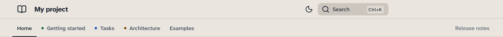

# Name your sections

Map your existing documentation folders to Tarn's Diátaxis colours without renaming
folders or changing page URLs. For example, a site with a `tasks` folder can
use the blue how-to navigation dot and automatic “How-to guide” badge.

Use this guide with Tarn selected as your theme and navigation defined in
`zensical.toml`. Tarn already recognises the usual
[section folders](../reference/section-folders.md). Add mappings only for
folders whose classification you want to change.

The examples below assume a site with this layout, with pages already included
in your navigation:

```text
my-docs/
├── zensical.toml
└── docs/
    ├── index.md
    ├── getting-started/index.md
    ├── tasks/deploy.md
    ├── architecture/index.md
    ├── examples/index.md
    └── release-notes/index.md
```

The `tasks/deploy.md` file becomes `tasks/deploy/` with Zensical's default
directory URLs. Substitute your own folder names in the mappings below.

<a id="steps"></a>

## Map your URL folders

Add a `project.extra.tarn.sections` table to `zensical.toml`. If the table
already exists, edit it rather than adding a second one:

```toml
[project.extra.tarn.sections]
getting-started = "tutorial"
tasks = "howto"
architecture = "explanation"
examples = "primary"
release-notes = "secondary"
```

Each key is the first segment of a site-relative URL, without slashes.
For example, `tasks/deploy/` uses `tasks`, even when your navigation title is
“Deployment”. A direct page such as `tasks.html` also uses `tasks`.
If your site is published under `/project/`, leave that deployment prefix
out of the key.

Choose each value for the navigation and badge that you want:

| Value | Navigation | Automatic page badge |
| --- | --- | --- |
| `tutorial` | Green dot | Tutorial |
| `howto` | Blue dot | How-to guide |
| `reference` | Slate dot | Reference |
| `explanation` | Ochre dot | Explanation |
| `primary` | Plain text without a dot | None |
| `secondary` | Quieter text without a dot | None |

These mappings override individual defaults. All other aliases remain active,
so `guides` still means `howto` unless you override it. Unrecognised folders
remain secondary. Use `primary` for a section such as `examples` when you want
ordinary navigation without an automatic badge.

## Put secondary sections at the end

In your existing `project.nav` list, place secondary entries together after
the main sections. With the example mappings, put “Release notes” after the
Diátaxis sections and “Examples”.

Tarn preserves your navigation order. Grouping secondary entries at the end
places them on the right of the tab bar, or below a separator in the sidebar.
Changing a classification does not move an entry for you.

<a id="final-result"></a>

## Check the mapped pages

Run `zensical serve` from your site directory, then open a page inside each
mapped folder. With navigation decoration and badges enabled, `tasks/deploy/`
has a blue navigation dot and a “How-to guide” badge above its title.
An `examples` page has plain navigation and no automatic badge. A
`release-notes` page has quieter navigation and no automatic badge.

If a result differs, check the first URL segment against the table key.
For a section with nested navigation, check its index or first linked page:
Tarn uses that page to classify the section. Also check that `enabled`,
`navigation`, and `badges` under `project.extra.tarn` allow the decoration
you expect. All three default to `true`.

<a id="next-steps"></a>

If an individual page needs a different badge, [set or remove its badge](set-page-type.md).
A page badge override does not change the section's navigation classification.
For all supported settings, see [Configuration](../reference/configuration.md).

## Example result

With these mappings and Release notes last in `nav`, the tab header looks like
this. Getting started, Tasks and Architecture have coloured dots. Examples has
no dot, and Release notes uses quieter text on the right.


