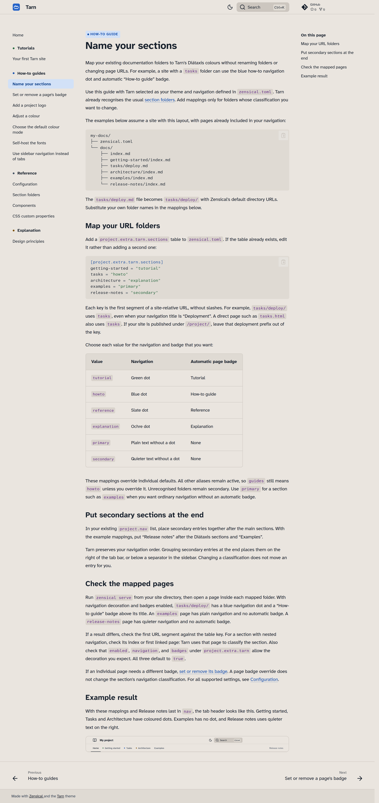

# Use sidebar navigation instead of tabs

Tarn puts top-level sections in header tabs by default. Use a sidebar to keep
those sections and their pages together in one navigation list.

In your site's `zensical.toml`, replace `navigation.tabs` with
`navigation.sections` in `[project.theme].features`. If you use Tarn's default
features, use this complete list. Update the existing `[project.theme]` table
if it is already present:

```toml title="zensical.toml"
[project.theme]
name = "tarn"
features = [
  "navigation.sections",
  "navigation.indexes",
]
```

!!! note "Keep the other features"

    Setting `features` replaces the theme's whole list. It does not append to
    that list. Keep `navigation.indexes`, plus any additional features
    your project uses. See [Configuration](../reference/configuration.md#zensical-defaults-supplied-by-tarn)
    for the theme defaults.

Run `zensical serve` from your site directory and open the preview at desktop
width. Make sure that the header tabs disappear and the top-level sections
appear in the sidebar. With Tarn's navigation decoration enabled, the sidebar
follows the same rules as the tabs:

- Each Diátaxis section's heading has a dot in its colour.
- Secondary sections, such as About and Contributing, use quieter text below a hairline.
- The current page is highlighted in blue.

Keep secondary sections together at the end of your project's `nav` list to
place them below the separator. Open a page in another section to check that
the current-page highlight follows it.



If a section has the wrong decoration, check its classification in
[Section folders](../reference/section-folders.md). To change that classification,
follow [Name your sections](name-sections.md).
