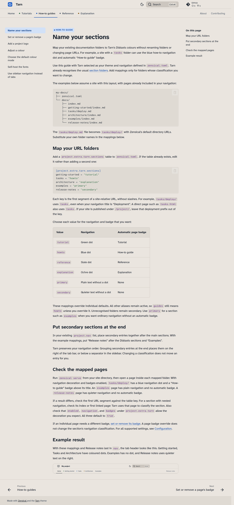
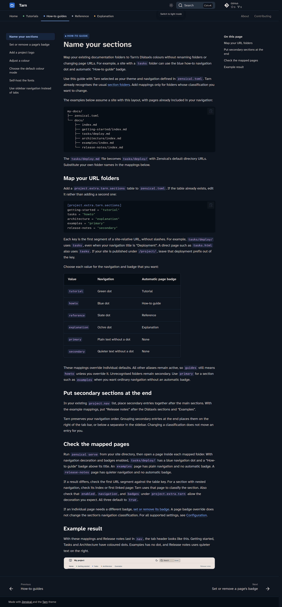

---
tarn:
  type: none
---
# Tarn

Tarn is a documentation theme for [Zensical](https://zensical.org), with calm colours and legible type. It styles your configured navigation and can mark tutorials, how-to guides, reference and explanation with distinct colours and page badges.

<div class="tarn-theme-previews">
  <figure>
    <figcaption>Light</figcaption>
    <a href="assets/screenshots/site-howto-light.png">
      
    </a>
  </figure>
  <figure>
    <figcaption>Dark</figcaption>
    <a href="assets/screenshots/site-howto-dark.png">
      
    </a>
  </figure>
</div>

[Get started](tutorials/first-site.md){ .md-button .md-button--primary } [Configuration reference](reference/configuration.md){ .md-button }

## What you get

- Diátaxis navigation cues. Tarn enables tabs by default and colours recognised documentation sections. Your Zensical configuration determines the sections and their order.
- Optional page badges. Recognised page URLs receive a Tutorial, How-to guide, Reference or Explanation badge by default. You can override individual badges or disable them.
- Light and dark palettes. The packaged defaults follow the reader's system preference unless the reader saves a choice. This documentation site starts in light mode.
- Legible type. Atkinson Hyperlegible Next and Atkinson Hyperlegible Mono distinguish characters such as `l`, `1`, `I`, `0` and `O`.
- Flat styling. A neutral header, thin dividing lines and five admonition tones keep the visual emphasis on the content.

Use [your own logo](how-to/add-project-logo.md),
[adjust the colours](how-to/adjust-colours.md) or change the fonts through
[Zensical configuration](reference/configuration.md#fonts-and-css).

## Install

Tarn is being prepared for its first release. With Python 3.11 or newer and an
active virtual environment, install it from the source checkout's root:

```bash
python -m pip install .
```

This also installs the pinned Zensical dependency. The package is
`zensical-tarn`, and its Zensical theme name is `tarn`:

```toml title="zensical.toml"
[project.theme]
name = "tarn"
```

After publication, `python -m pip install zensical-tarn` will install the
published package from PyPI.

The [first-site tutorial](tutorials/first-site.md) covers installation and navigation configuration for a working site.
